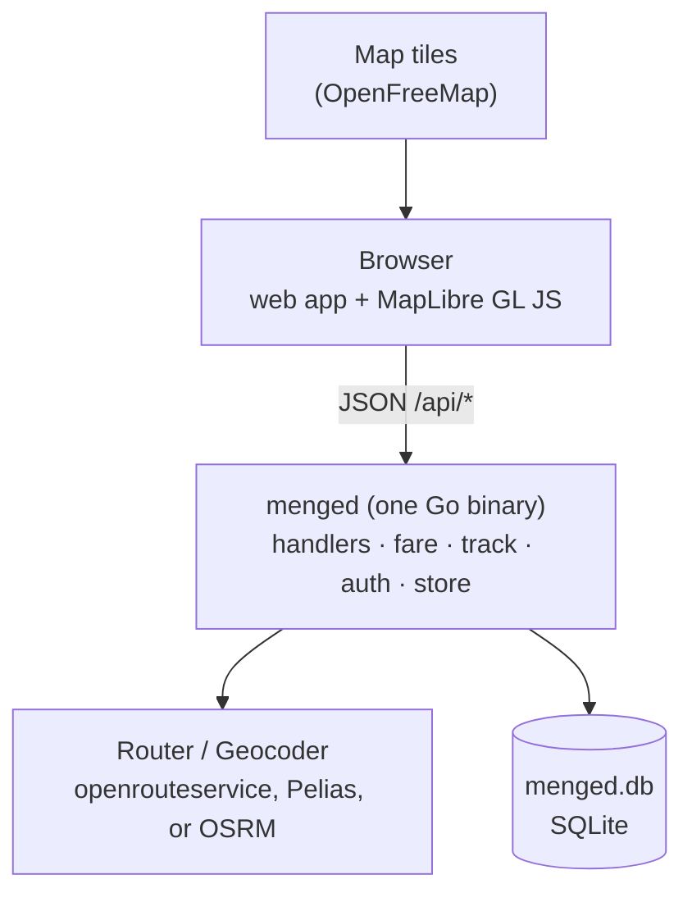

# Architecture

menged is a single Go process that serves a small web app and a JSON API, prices trips,
and keeps each user's trips in SQLite. Routing and place search come from external
providers behind two interfaces.



## Server

The server exists for two reasons. The routing API key has to stay out of the browser,
and trip history has to outlive browser storage. It is also the only place a fare is
calculated: clients send points or a GPS track, never a price. That keeps one formula and
one rate card in charge.

The HTTP layer is the standard library's `net/http` with method-and-path patterns
(`POST /api/trips`). The static web app is embedded into the binary with `//go:embed`,
so a deployment is one file plus its config.

The code is one flat `package main`:

| File | Responsibility |
|------|----------------|
| `main.go`, `config.go` | Flags, config loading with `${ENV}` expansion, startup and shutdown |
| `handlers.go` | API routes, request validation, JSON responses |
| `fare.go` | The fare formula, a pure function |
| `track.go` | Turning a recorded GPS track into distance, moving time and waiting time |
| `geo.go` | `Router` and `Geocoder` interfaces, service area, caching and retries |
| `ors.go`, `osrm.go` | openrouteservice directions and Pelias geocoding; OSRM directions |
| `auth.go` | Users, sessions, sign-in, password reset, the per-user guard |
| `mail.go` | Sending reset emails through Mailtrap, or writing them to the log |
| `store.go`, `schema.sql` | SQLite access and schema |

The HTTP API is described in [openapi.yaml](openapi.yaml).

## Routing and geocoding

```go
type Router interface {
    Route(ctx context.Context, pts []Point) (Route, error) // pickup, stops, destination
}

type Geocoder interface {
    Autocomplete(ctx context.Context, q string, near Point) ([]PlaceHit, error)
    Reverse(ctx context.Context, p Point) (string, error)
}
```

`routing.provider` selects openrouteservice (hosted, needs a key) or OSRM (self-hosted).
Either one is wrapped in a short-lived in-memory cache keyed on rounded coordinates, with
one retry on transient errors. A pin with no road nearby comes back as `ErrUnroutable`
and reaches the client as a 422 with a readable message. Reverse labels are cached too,
so nudging a pin doesn't spend quota. Providers and their limits are in
[geospatial.md](geospatial.md).

Points outside a bounding box around Ethiopia are rejected before any provider is
called. The map's default camera and pan limits are around Addis Ababa and come from
`/api/config`.

## Storage

SQLite through `modernc.org/sqlite`, a pure-Go driver, so the binary cross-compiles
without cgo. The database runs in WAL mode with foreign keys on, through a single
connection. At this scale (a few writers, thousands of rows a year) that avoids
locking errors without any tuning. Backup is a copy of the file.

[schema.sql](../schema.sql) is the reference for the tables: users, sessions,
password resets, trips and places. It is applied with `CREATE TABLE IF NOT EXISTS` at
startup. Two choices in it matter:

- Every trip stores the rates that priced it, next to the result. Raising your per-km
  rate later doesn't change what old trips say.
- `suggested_fare` sits next to `actual_charged`. After enough trips, the gap between
  them shows whether the rate card matches what passengers pay.

Until v1 there are no migrations: a schema change means starting a new database file.

## Web app

One `index.html`, `app.js` and `style.css`, with no framework or build step. MapLibre GL
JS is loaded from a CDN, pinned to an exact version with a subresource-integrity hash.
`manifest.json` lets the page be added to a phone's home screen. There is no service
worker, so the app needs a connection.

Everything happens on one screen. A quote appears as soon as both pins are set. The trip
log opens as a panel over the map.

**Recorded trips.** "Start trip" collects GPS fixes (at most one every 2 s) while a
screen wake lock is held. The fixes are kept in `localStorage`, so a reload resumes the
trip. About every 30 s the live meter sends the track to `/api/measure` without routing;
"End trip" sends it with routing on, and that result is what gets saved. A web page gets
no GPS in the background, so menged has to stay on screen while recording. How the
track is measured is described in [fares.md](fares.md).

## Sign-in

Quotes, trip measurement and place search are public. Trips and saved places belong to a
user, so those endpoints need a session.

- **Accounts** are an email and a password (bcrypt). Anyone can sign up unless
  `server.signup` is `false`. The email isn't confirmed at sign-up. A reset link only
  works for whoever reads that inbox, so the owner of the address can always take the
  account back.
- **Sessions** are random tokens in an `HttpOnly`, `SameSite=Lax` cookie, `Secure` behind
  TLS. Only a SHA-256 of the token is stored. A session lasts 90 days and is extended
  when used, so a phone in daily use stays signed in.
- **Password reset** emails a single-use link valid for an hour. The link is built from
  `server.public_url`, never from the request's `Host` header. The forgot-password
  answer is the same whether or not the account exists. Using the link ends every
  session for that account. On the server, `menged -reset-password EMAIL` does the same
  without email.
- **Cross-site requests** that change state are refused by Go's
  `http.CrossOriginProtection`. That also covers sibling subdomains, which `SameSite`
  treats as the same site.
- **Isolation**: every trip and place query is scoped to the session's user. Another
  user's ID answers 404.

The web app asks for sign-in when it's needed (opening the trip log, saving, starting a
trip) and then carries on with what you were doing.

## What isn't here

There is no Redis, message queue, object storage, role system or WebSocket. Nothing in
the workflow needs them: users only see their own rows, nothing runs in real time, and
there are no files to store. Postgres would be the first addition, if several drivers
ever wrote at the same time; see [roadmap.md](roadmap.md).
